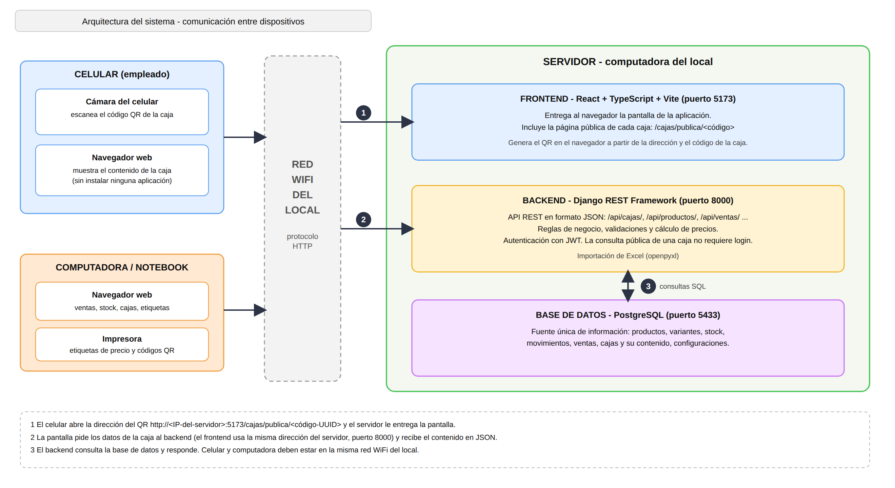
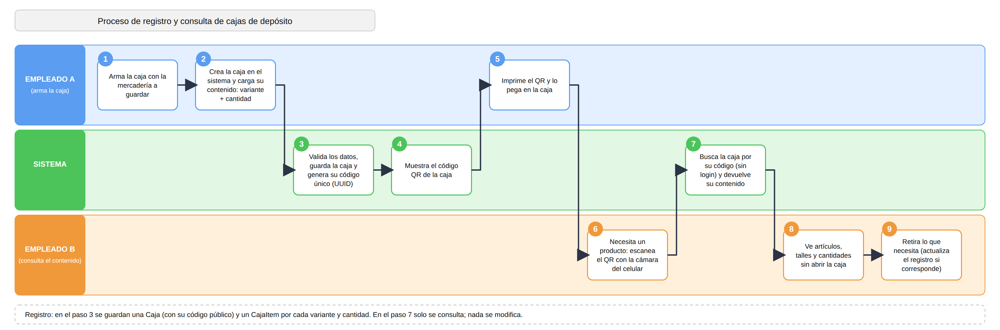

# Arquitectura y comunicación entre dispositivos

## Descripción

El sistema sigue una arquitectura **cliente-servidor**. La información se guarda y se procesa en una computadora del local (el servidor), y los empleados acceden a ella desde distintos dispositivos mediante un navegador web: un celular, una computadora o una notebook.

No es necesario instalar ninguna aplicación en los dispositivos que consultan el sistema.

---

## Diagrama de arquitectura

---

## Componentes

| Componente | Tecnología | Función |
| --- | --- | --- |
| Frontend | React, TypeScript y Vite (puerto 5173) | Entrega la pantalla de la aplicación y gestiona la interacción con el usuario. Genera los códigos QR en el navegador. |
| Backend | Django y Django REST Framework (puerto 8000) | Expone la API REST en formato JSON, aplica las reglas de negocio, valida los datos, calcula los precios, importa archivos Excel y controla la autenticación con JWT. |
| Base de datos | PostgreSQL (puerto 5433) | Conserva toda la información: productos, variantes, stock, movimientos, ventas, cajas y configuraciones. |
| Dispositivos cliente | Navegador web | Celular, computadora o notebook que se conectan al servidor por la red WiFi del local. |

El frontend no guarda información por su cuenta. Todos los datos pasan por la API del backend, que es la única que accede a la base de datos.

---

## Comunicación entre dispositivos

La comunicación se realiza mediante el protocolo HTTP sobre la red WiFi del local. El caso más claro es la consulta del contenido de una caja desde un celular:

1. El empleado escanea el código QR de la caja con la cámara del celular.
2. El QR contiene una dirección con la forma `http://<IP-del-servidor>:5173/cajas/publica/<código>`. El celular la abre en su navegador y el servidor le entrega la pantalla.
3. La pantalla pide al backend los datos de esa caja. El frontend detecta automáticamente la dirección del backend: usa el mismo equipo desde el que se abrió la aplicación, en el puerto 8000.
4. El backend busca la caja por su código, consulta la base de datos y responde con el contenido en formato JSON.
5. El celular muestra los artículos, talles y cantidades registrados, sin necesidad de abrir la caja.

Para que esto funcione, el celular y el servidor deben estar conectados a la misma red WiFi.

### Acceso público y acceso con sesión

La consulta del contenido de una caja por su código es la única operación que no requiere iniciar sesión, porque quien escanea el QR necesita ver la información de forma inmediata. El código es un identificador único (UUID) que no puede adivinarse.

El resto de las operaciones (ventas, stock, productos, cajas, configuración e importación) requiere iniciar sesión y se autentican mediante JWT.

---

## Proceso de las cajas de depósito

### Registro de la caja (empleado A)

1. Arma la caja con la mercadería que va a guardar.
2. Crea la caja en el sistema y carga su contenido: cada variante de producto con su cantidad.
3. El sistema valida los datos, guarda la caja y genera su código público único.
4. El sistema muestra el código QR de la caja.
5. El empleado imprime el QR y lo pega en la caja.

### Consulta del contenido (empleado B)

6. Cuando necesita un producto, escanea el QR con la cámara del celular.
7. El sistema busca la caja por su código y devuelve su contenido.
8. El empleado ve los artículos, talles y cantidades sin abrir la caja.
9. Retira lo que necesita y, si corresponde, actualiza el registro de la caja.

### Registro que se conserva

Al crear una caja se guardan:

- una **Caja**, con su código público, su nombre opcional y su fecha de creación;
- un **CajaItem** por cada variante de producto incluida, con su cantidad.

La consulta mediante QR solo lee esta información: no modifica nada. La estructura de estas tablas se describe en [modelo-datos.md](modelo-datos.md).

---

## Limitaciones actuales

- **Dirección de los QR**: el QR contiene la dirección del servidor en la red local. Si la IP de la computadora cambia, los QR ya impresos dejan de funcionar. Se evalúa reservar una IP fija en el router o publicar el sistema con un dominio propio.
- **HTTP**: la comunicación se realiza sin cifrar. Para un uso fuera de la red local es necesario incorporar HTTPS.
- **Misma red**: el celular debe estar conectado a la red WiFi del local para consultar una caja.