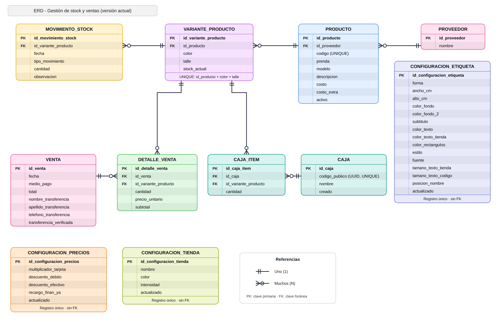

# Modelo de datos

## Descripción

El modelo de datos fue diseñado a partir del relevamiento del proceso actual de gestión de ventas e inventario.

El objetivo es representar de forma estructurada los productos, sus diferentes variantes, las existencias disponibles, los movimientos de inventario, las operaciones de venta, la configuración utilizada para el cálculo de precios, la personalización de la tienda y de las etiquetas, y las cajas de depósito con su contenido.

Se identificaron once entidades principales, agrupadas en tres áreas.

Catálogo, inventario y ventas:

- Proveedor
- Producto
- VarianteProducto
- MovimientoStock
- Venta
- DetalleVenta

Configuración del sistema:

- ConfiguracionPrecios
- ConfiguracionTienda
- ConfiguracionEtiqueta

Depósito:

- Caja
- CajaItem

---

## Diagrama Entidad-Relación



> El diagrama representa las once entidades del modelo implementado, incluyendo las configuraciones del sistema y las cajas de depósito con su contenido.

---

## Proveedor

Representa a los proveedores de mercadería.

Un proveedor puede estar asociado a múltiples productos.

Relación:

```text
Proveedor 1:N Producto
```

La información del proveedor se mantiene separada de `Producto` para evitar repetir sus datos en cada artículo asociado.

---

## Producto

Representa el producto general identificado mediante un código.

Contiene información como:

- Código
- Prenda
- Modelo
- Descripción
- Costo
- Costo extra
- Estado
- Proveedor

El código se almacena como texto debido a que representa un identificador y no un valor destinado a operaciones matemáticas.

Cada código debe ser único.

El campo de estado permite mantener productos activos o inactivos sin necesidad de eliminar información histórica.

Los valores de costo y costo extra pertenecen a cada producto y pueden variar entre productos.

A partir de estos valores y de los parámetros generales almacenados en `ConfiguracionPrecios`, el backend calcula los precios correspondientes a los diferentes medios de pago.

Relaciones:

```text
Proveedor 1:N Producto

Producto 1:N VarianteProducto
```

---

## VarianteProducto

Representa una combinación específica de color y talle correspondiente a un producto.

Ejemplo:

```text
Producto:
8019 - Jean Mom

Variantes:
- Azul / 38
- Azul / 40
- Negro / 38
- Negro / 40
```

Cada variante mantiene su propio `stock_actual`.

Esto permite conocer la disponibilidad de una combinación concreta de producto, color y talle sin tener que calcular permanentemente el stock a partir de todo el historial de movimientos.

Relación:

```text
Producto 1:N VarianteProducto
```

La combinación:

```text
Producto + Color + Talle
```

debe ser única.

Esta restricción evita duplicar variantes y permite incrementar el stock de una variante existente cuando ingresa nueva mercadería.

---

## MovimientoStock

Representa cada modificación realizada sobre el inventario.

Los tipos de movimiento considerados inicialmente son:

- ENTRADA
- VENTA
- AJUSTE

Cada movimiento se encuentra asociado a una variante específica e identifica la cantidad involucrada y el momento en que se produjo la modificación.

Relación:

```text
VarianteProducto 1:N MovimientoStock
```

La existencia de esta entidad permite mantener trazabilidad sobre las modificaciones del inventario.

Mientras `stock_actual` permite conocer cuánto stock existe en un momento determinado, `MovimientoStock` permite conservar información sobre las operaciones que produjeron sus variaciones.

Los movimientos generados por operaciones de negocio, como una venta o un ingreso de mercadería, se crean automáticamente como parte de dichas operaciones.

---

## Venta

Representa una operación de venta completa.

Contiene:

- Fecha
- Medio de pago
- Total
- Nombre del cliente para transferencia
- Apellido del cliente para transferencia
- Teléfono del cliente para transferencia
- Estado de verificación de la transferencia

Los datos de nombre, apellido y teléfono se utilizan cuando el medio de pago seleccionado es `TRANSFERENCIA`.

Estos datos permiten conservar información de contacto del cliente para verificar posteriormente la acreditación del pago y comunicarse con él ante cualquier inconveniente.

Las ventas realizadas mediante transferencia se registran inicialmente como pendientes de verificación.

Una vez comprobada la acreditación del pago, el estado de la transferencia puede modificarse a verificada sin alterar los restantes datos de la venta.

Una venta puede contener uno o múltiples artículos.

Por este motivo, los productos vendidos no se almacenan directamente en la entidad `Venta`, sino mediante sus detalles.

Relación:

```text
Venta 1:N DetalleVenta
```

El total de la venta se obtiene a partir de los subtotales correspondientes a sus detalles.

---

## DetalleVenta

Representa cada artículo incluido dentro de una venta.

Contiene:

- Venta
- Variante del producto
- Cantidad
- Precio unitario
- Subtotal

Relaciones:

```text
Venta 1:N DetalleVenta

VarianteProducto 1:N DetalleVenta
```

La relación se realiza con `VarianteProducto` y no directamente con `Producto` debido a que el sistema necesita identificar exactamente qué combinación de talle y color fue vendida para actualizar correctamente el stock.

El precio unitario registrado en el detalle corresponde al precio aplicado al momento de realizar la venta.

De esta forma, una modificación futura del costo o de las reglas de precios del producto no altera la información histórica de una venta ya registrada.

---

## ConfiguracionPrecios

Representa la configuración centralizada de los parámetros utilizados por el sistema para calcular los precios correspondientes a los diferentes medios de pago.

La configuración permite administrar los valores utilizados en las reglas comerciales sin necesidad de modificar directamente el código fuente.

Contiene los parámetros necesarios para calcular:

- precio de tarjeta;
- precio de débito;
- precio de efectivo y transferencia;
- precio de Fast Cred;
- precio de Finan Ya.

Las reglas comerciales parten de la siguiente estructura:

```text
Precio tarjeta = (Costo × multiplicador) + Costo extra
Precio débito = Precio tarjeta - porcentaje configurado
Precio efectivo / transferencia = Precio tarjeta - porcentaje configurado
Precio Fast Cred = Precio efectivo
Precio Finan Ya = Precio efectivo + porcentaje configurado
```

Los valores configurados son utilizados por el backend al calcular los precios de los productos.

`ConfiguracionPrecios` no necesita una relación directa mediante clave foránea con `Producto`, ya que representa una configuración general utilizada por las reglas de negocio del sistema.

De esta manera, los productos conservan sus propios valores de costo y costo extra, mientras que los parámetros generales de cálculo se administran de forma centralizada.

---

# Decisiones de diseño

## ConfiguracionTienda

Representa la personalización visual de la aplicación para la tienda.

Contiene:

- Nombre de la tienda
- Color principal (rosa, celeste, verde, violeta, mostaza o gris)
- Intensidad del color (suave, medio o fuerte)
- Fecha de última actualización

Al igual que `ConfiguracionPrecios`, es una configuración general: existe un único registro, que se crea automáticamente la primera vez que se consulta, y no se relaciona mediante clave foránea con otras entidades.

El nombre de la tienda se utiliza en la interfaz y en las etiquetas de precio.

---

## ConfiguracionEtiqueta

Representa los parámetros de diseño de las etiquetas de precio que el sistema genera para imprimir.

Contiene:

- Forma (rectangular, cuadrada o circular)
- Dimensiones en centímetros (ancho y alto; en la forma circular el ancho se usa como diámetro)
- Colores de fondo (con un segundo color para degradé), de texto, de nombre de la tienda y de los recuadros
- Subtítulo opcional
- Estilo (simple, con borde, bordes suaves, relleno sólido o marco doble)
- Fuente y tamaños de letra, expresados en puntos para lograr una impresión consistente
- Posición del nombre de la tienda dentro de la etiqueta

También es una configuración general con un único registro.

Las etiquetas generadas no se almacenan en la base de datos: se componen a partir del producto, su variante y esta configuración, y se envían a imprimir. De esta manera, el diseño se define una vez y se aplica a todos los lotes de etiquetas.

---

## Caja

Representa una unidad de almacenamiento del depósito, como las cajas donde se guarda la mercadería que no se exhibe en el local.

Contiene:

- Código público (UUID)
- Nombre opcional
- Fecha de creación

El código público es un identificador único generado automáticamente, que no puede editarse. Es el dato que se incluye en el código QR impreso y pegado en la caja.

Se utiliza un UUID y no el identificador numérico de la caja porque la consulta mediante QR no requiere iniciar sesión. Un número secuencial permitiría recorrer fácilmente todas las cajas; un UUID no es adivinable.

Relación:

```text
Caja 1:N CajaItem
```

---

## CajaItem

Representa el registro del contenido de una caja: cada línea indica qué variante de producto contiene y en qué cantidad.

Contiene:

- Caja
- Variante del producto
- Cantidad

Ejemplo:

```text
Caja: "Remeras verano"

Contenido:
- 8019 / Azul / 38  x 4
- 8019 / Negro / 40 x 2
- 7312 / Blanco / M x 6
```

Relaciones:

```text
Caja 1:N CajaItem

VarianteProducto 1:N CajaItem
```

La relación se realiza con `VarianteProducto` y no con `Producto`, porque para ubicar una prenda se necesita conocer la combinación exacta de color y talle.

La cantidad debe ser al menos 1.

Si se elimina una caja, se eliminan sus registros de contenido. En cambio, una variante que figura en una caja no puede eliminarse, para no dejar registros de contenido apuntando a un producto inexistente.

---

## Separación entre Producto y VarianteProducto

Durante el relevamiento se detectó que un mismo código puede aparecer múltiples veces debido a las diferentes combinaciones de talle y color.

Por este motivo se separó el concepto general de `Producto` de sus variantes.

Esto evita duplicar información general como descripción, modelo, costo y proveedor.

---

## Separación entre Venta y DetalleVenta

Una misma operación puede incluir múltiples prendas.

`Venta` representa la operación general, mientras que `DetalleVenta` representa cada artículo incluido en ella.

Este diseño permite registrar una única venta con múltiples productos o variantes.

---

## Centralización de la configuración de precios

Las reglas comerciales utilizadas para calcular los precios dependen de parámetros generales que pueden modificarse con el tiempo.

Por este motivo, dichos parámetros se almacenan mediante `ConfiguracionPrecios` en lugar de mantenerse exclusivamente como valores fijos dentro del código fuente.

La separación permite distinguir entre:

```text
Producto
    ↓
Costo + Costo extra

ConfiguracionPrecios
    ↓
Parámetros generales de cálculo

        ↓

Precios por medio de pago
```

El backend combina ambos tipos de información para obtener los precios correspondientes.

Esta decisión permite modificar los parámetros comerciales desde el sistema manteniendo centralizada en el backend la lógica responsable del cálculo.

---

## Datos y verificación de transferencias

Las ventas realizadas mediante transferencia requieren información adicional debido a que la acreditación del pago puede verificarse posteriormente.

Por este motivo, `Venta` conserva:

- nombre del cliente;
- apellido del cliente;
- teléfono;
- estado de verificación de la transferencia.

Estos datos pertenecen a la propia operación y no justifican actualmente la creación de una entidad `Cliente`, ya que el sistema no contempla una gestión general de clientes dentro del alcance de la primera versión.

El estado de verificación permite representar el siguiente flujo:

```text
Venta por transferencia
        ↓
Pendiente de verificación
        ↓
Comprobación de acreditación
        ↓
Transferencia verificada
```

La modificación del estado de verificación no afecta el stock, los movimientos de inventario, los detalles ni el importe histórico de la venta.

---

## Stock actual e historial de movimientos

El sistema mantiene dos conceptos relacionados pero diferentes:

```text
VarianteProducto.stock_actual
        ↓
Disponibilidad actual

MovimientoStock
        ↓
Historial de modificaciones
```

`stock_actual` permite realizar consultas rápidas sobre disponibilidad.

`MovimientoStock` conserva la trazabilidad de entradas, ventas y ajustes.

De esta manera no es necesario reconstruir todo el historial cada vez que se necesita conocer el stock disponible.

---

## Ingreso y reposición de mercadería

El ingreso de mercadería utiliza el código para determinar si el producto ya existe.

### Producto inexistente

Si el código no existe:

```text
Crear Producto
      ↓
Crear Variante
      ↓
Incrementar stock
      ↓
Registrar ENTRADA
```

### Producto existente y variante nueva

Si el producto existe pero la combinación color + talle no existe:

```text
Utilizar Producto existente
      ↓
Crear nueva Variante
      ↓
Incrementar stock
      ↓
Registrar ENTRADA
```

### Producto y variante existentes

Si ambos existen:

```text
Utilizar Producto existente
      ↓
Utilizar Variante existente
      ↓
Sumar cantidad al stock
      ↓
Registrar ENTRADA
```

Durante una reposición, los datos generales del producto existente no se sobrescriben automáticamente.

Una modificación de descripción, modelo, costo, proveedor u otros datos generales debe realizarse explícitamente mediante la gestión del producto.

Esta decisión reduce la posibilidad de modificar accidentalmente información existente durante una reposición de stock.

---

## Venta y actualización de stock

Una venta afecta diferentes entidades del modelo:

```text
Venta
  ↓
DetalleVenta
  ↓
VarianteProducto.stock_actual
  ↓
MovimientoStock (VENTA)
```

La operación se ejecuta de manera transaccional.

Si se produce un error durante cualquiera de estos pasos, los cambios realizados dentro de la operación se revierten para evitar ventas parcialmente registradas o inconsistencias en el inventario.

La información adicional correspondiente a una transferencia forma parte de la propia `Venta` y se registra dentro de la misma operación.

---

## Medios de pago y persistencia

El sistema contempla diferentes medios de pago:

- Efectivo
- Transferencia
- Tarjeta de débito
- Tarjeta de crédito
- Fast Cred
- Finan Ya

El medio de pago utilizado se almacena en `Venta`.

Fast Cred y Finan Ya utilizan plataformas externas durante el proceso de cobro. El acceso a dichas plataformas forma parte del flujo del frontend, pero no genera nuevas entidades dentro del modelo de datos.

La venta se registra en la base de datos únicamente cuando el usuario confirma la operación dentro del sistema.

---

## Uso de valores decimales para importes

Los valores monetarios se representan mediante campos decimales.

Esta decisión evita los problemas de precisión que pueden producirse al utilizar números de punto flotante para operaciones monetarias.

Los parámetros porcentuales y multiplicadores utilizados para las reglas de precios también deben conservar una precisión adecuada para los cálculos realizados por el backend.

---

## Conservación de valores históricos de venta

El precio unitario y el subtotal se almacenan en `DetalleVenta`.

Esto permite conservar el valor aplicado al momento de la operación independientemente de modificaciones posteriores en:

- costo;
- costo extra;
- configuración de precios;
- reglas de cálculo.

Por lo tanto, las ventas históricas no dependen de recalcular los precios actuales del producto.

En las ventas realizadas mediante transferencia también se conservan los datos de contacto registrados en el momento de la operación y su estado de verificación.

La modificación posterior de la configuración general de precios no altera los importes correspondientes a ventas previamente registradas.

---

## Eliminación y conservación del historial

Se utilizan estrategias de protección en relaciones que contienen información histórica.

Una variante asociada a movimientos de stock o ventas no debe eliminarse si esto implica perder la trazabilidad de operaciones anteriores.

Los productos incluyen además un estado activo/inactivo para permitir retirar productos de la operatoria sin necesidad de eliminar su información histórica.

Un producto inactivo conserva sus datos y relaciones históricas, pero no puede utilizarse para registrar nuevas ventas.

Las ventas y sus detalles constituyen información histórica de las operaciones realizadas y deben conservarse para mantener la trazabilidad del sistema.

---

## Relación con el frontend

## Cajas de depósito y consulta mediante QR

La mercadería que no se exhibe en el local se guarda en cajas. Para saber qué contiene cada una sin abrirla, el sistema registra su contenido y genera un código QR.

El proceso es el siguiente:

```text
Un empleado arma la caja
        ↓
Registra en el sistema qué variantes y cantidades contiene
        ↓
El sistema genera el código público (UUID) de la caja
        ↓
Se imprime el QR y se pega en la caja
        ↓
Otro empleado escanea el QR con la cámara del celular
        ↓
El celular consulta al sistema y muestra el contenido registrado
```

El QR contiene la dirección de la página pública de la caja, formada por la dirección desde la que se abrió la aplicación y el código público de la caja.

La consulta pública es la única operación del módulo que no requiere iniciar sesión, porque quien escanea el QR debe poder ver el contenido de forma inmediata. Crear, listar, editar y eliminar cajas requiere sesión iniciada.

Una caja es un **registro de ubicación**, no una modificación del inventario: crear o editar una caja no genera movimientos de stock ni modifica `stock_actual`. La mercadería ya figura como stock desde su ingreso; la caja solo indica dónde está guardada.

Por este motivo, el contenido de una caja refleja lo que se registró al cargarla o editarla. Las ventas no lo actualizan automáticamente, por lo que debe modificarse manualmente cuando se retira mercadería de la caja.

---

## Importación desde Excel

La tienda contaba con su información en planillas de cálculo independientes. Para evitar volver a cargar manualmente todo el catálogo y el stock, el sistema permite importar esos datos desde archivos Excel.

La importación **no agrega entidades nuevas**: trabaja sobre `Proveedor`, `Producto` y `VarianteProducto`.

Se realiza en dos cargas que deben hacerse en este orden:

1. **Catálogo y precios**: código, descripción, costo, costo extra y proveedor.
2. **Stock**: código, color, talle y cantidad.

En la carga de catálogo, el producto se identifica por su código: si existe, se actualiza; si no existe, se crea. El proveedor se busca por nombre sin distinguir mayúsculas y se crea si no existe.

En la carga de stock, la variante se identifica por producto, color y talle. Si el código no corresponde a un producto existente, pero la fila incluye prenda, costo y proveedor, el producto se crea en ese momento, porque puede tratarse de mercadería nueva.

Las filas con errores no detienen la importación: se informan junto con el motivo y pueden corregirse manualmente desde la pantalla de importación. Tanto la importación como la corrección manual utilizan las mismas reglas de validación.

Por tratarse de una **carga inicial**, la importación de stock se diferencia del ingreso de mercadería:

```text
Ingreso de mercadería
    → suma la cantidad al stock existente
    → registra un movimiento ENTRADA

Importación de stock
    → establece el stock de la variante con la cantidad del archivo
    → no registra movimientos
```

---

El modelo de datos pertenece al backend y constituye la fuente de verdad del sistema.

El frontend desarrollado con React no mantiene una base de datos independiente ni modifica directamente la persistencia.

La información visualizada en la interfaz se obtiene mediante la API REST y las operaciones realizadas desde el frontend se envían al backend para su validación y procesamiento.

La arquitectura mantiene el siguiente flujo:

```text
React
  ↓
API REST
  ↓
Django REST Framework
  ↓
Models
  ↓
PostgreSQL
```

De esta forma:

- PostgreSQL conserva la información persistente;
- Django aplica las reglas de negocio, validaciones y cálculos;
- React se encarga de la interacción con el usuario y la presentación de los datos.

Esta separación evita mantener estados persistentes duplicados entre frontend y backend y permite conservar una única fuente de verdad para la información del sistema.

---

## Datos derivados para el dashboard

Las métricas mostradas en el dashboard no requieren entidades adicionales dentro del modelo.

Valores como:

- ventas realizadas durante el día;
- total vendido durante el día;
- ventas realizadas durante el mes;
- total vendido durante el mes;
- variantes con stock bajo;
- variantes sin stock;

se obtienen mediante consultas sobre las entidades existentes.

Por ejemplo:

```text
Venta
  ↓
Cantidad y totales por fecha

VarianteProducto
  ↓
Stock bajo / sin stock
```

Esta decisión evita almacenar información redundante que puede calcularse a partir de los datos persistidos.

---

## Resumen de relaciones

Las principales relaciones del modelo pueden representarse de la siguiente manera:

```text
Proveedor
   │
   │ 1:N
   ↓
Producto
   │
   │ 1:N
   ↓
VarianteProducto
   │
   ├──────── 1:N ────────> MovimientoStock
   │
   └──────── 1:N ────────> DetalleVenta
                                ↑
                                │ N:1
                                │
                              Venta


ConfiguracionPrecios
        │
        └── Configuración global utilizada
            por las reglas de cálculo
            de precios del backend
```

`ConfiguracionPrecios`, `ConfiguracionTienda` y `ConfiguracionEtiqueta` funcionan como configuraciones generales del sistema: cada una tiene un único registro y no requiere una relación mediante clave foránea con las restantes entidades.

Las cajas de depósito se vinculan con el catálogo a través de `CajaItem`:

```text
Caja
  │
  │ 1:N
  ↓
CajaItem ────── N:1 ──────> VarianteProducto
```

El modelo permite mantener separadas las responsabilidades relacionadas con catálogo, inventario, ventas, trazabilidad y configuración comercial.